# Redis cho người mới bắt đầu

> **Cách đọc tài liệu này**
> - Đọc lần lượt **mục 1 → 5** trước. Đây là phần nền tảng, mở `redis-cli` và gõ thử từng lệnh.
> - **Mục 6 → 11** là kiến thức vận hành (production). Đọc sau khi đã quen các lệnh cơ bản.
> - Gặp từ lạ? Xem **Bảng thuật ngữ** ở cuối tài liệu.
> - Làm bài tập trong `Exercises.md` sau khi đọc xong mỗi phần.

---

## 1. Redis là gì? Tại sao cần nó?

### Hình dung đơn giản

Tưởng tượng bạn làm thủ thư:

- **Kho sách ở tầng hầm** = database thông thường (MySQL, SQL Server…). Chứa được rất nhiều, an toàn, nhưng mỗi lần lấy sách phải đi xuống hầm → **chậm**.
- **Cái bàn ngay trước mặt** = Redis. Bạn để sẵn vài cuốn sách hay được mượn nhất lên bàn → ai hỏi là đưa ngay → **rất nhanh**. Nhưng bàn thì nhỏ, không chứa được hết.

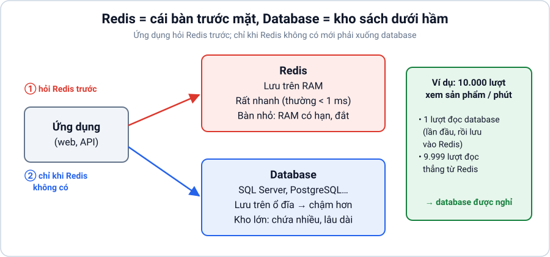

Redis nhanh vì nó lưu dữ liệu trên **RAM** (bộ nhớ trong) thay vì trên **ổ đĩa**. Đọc RAM nhanh hơn đọc ổ đĩa rất nhiều lần.

### Redis lưu dữ liệu như thế nào?

Redis lưu dữ liệu theo dạng **key → value** (khóa → giá trị), giống một cuốn từ điển:

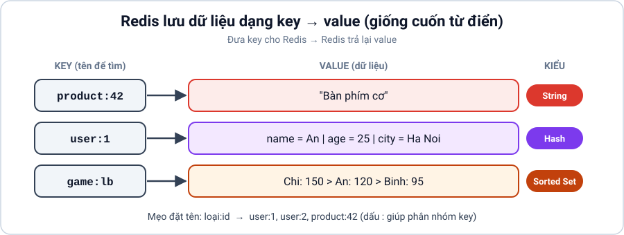

Muốn lấy dữ liệu, bạn đưa **key** cho Redis, Redis trả lại **value**.

### Ví dụ thực tế: trang web bán hàng

Trang chi tiết sản phẩm có 10.000 người xem mỗi phút. Nếu mỗi lượt xem đều hỏi database → database quá tải.

Giải pháp: lần đầu đọc database rồi **lưu tạm kết quả vào Redis**. 9.999 lượt sau đọc từ Redis → nhanh và database được nghỉ ngơi. Cách làm này gọi là **cache** (bộ nhớ đệm).

---

## 2. Năm thuật ngữ cần biết trước

Chỉ cần nắm 5 từ này để bắt đầu. Các thuật ngữ khác sẽ được giải thích khi gặp.

| Thuật ngữ | Nghĩa | Ví dụ |
|---|---|---|
| **Key** | Tên dùng để tìm dữ liệu. Nên đặt theo dạng `loại:id`, dùng dấu `:` để phân nhóm. | `user:1`, `product:42`, `cart:user:1` |
| **Value** | Dữ liệu gắn với key. Có nhiều kiểu (xem mục 4). | `"Bàn phím cơ"` |
| **TTL** (Time To Live – "thời gian sống") | Số giây còn lại trước khi key **tự động bị xóa**. Giống hạn sử dụng của hộp sữa. | `SET otp:0901 "123456" EX 60` → mã OTP tự xóa sau 60 giây |
| **Cache** | Bản sao tạm của dữ liệu để đọc nhanh hơn. Mất cache thì vẫn lấy lại được từ database. | Lưu thông tin sản phẩm 5 phút |
| **Cache hit / Cache miss** | *Hit*: tìm thấy trong cache. *Miss*: không có trong cache (chưa lưu hoặc đã hết hạn), phải đọc database. | `GET` trả về dữ liệu = hit; trả về `(nil)` = miss |

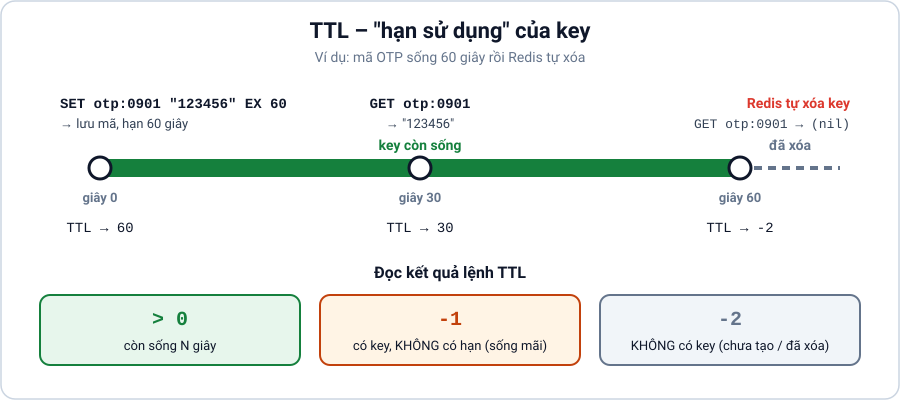

### Đọc kết quả lệnh `TTL`

| Kết quả | Ý nghĩa |
|---|---|
| Số dương, ví dụ `(integer) 295` | Key còn sống 295 giây nữa |
| `(integer) -1` | Key tồn tại nhưng **không có hạn**, sẽ sống mãi đến khi bị xóa |
| `(integer) -2` | Key **không tồn tại** (chưa tạo, đã hết hạn hoặc đã bị xóa) |

---

## 3. Thử ngay: 5 phút đầu tiên với `redis-cli`

Mở terminal, gõ `redis-cli` để vào chế độ tương tác. Gõ từng dòng sau dấu `>` và so sánh với kết quả bên dưới.

```text
127.0.0.1:6379> PING
PONG                                  ← Redis đang chạy

127.0.0.1:6379> SET greeting "Xin chao"
OK                                    ← đã lưu

127.0.0.1:6379> GET greeting
"Xin chao"                            ← đọc ra

127.0.0.1:6379> TTL greeting
(integer) -1                          ← không có hạn

127.0.0.1:6379> EXPIRE greeting 10
(integer) 1                           ← đặt hạn 10 giây (1 = thành công)

127.0.0.1:6379> TTL greeting
(integer) 7                           ← còn 7 giây

  ... đợi hơn 10 giây ...

127.0.0.1:6379> GET greeting
(nil)                                 ← đã tự xóa. (nil) = "không có gì"
```

> 💡 `(nil)` nghĩa là key không tồn tại. Trong code C#, kết quả này tương ứng với giá trị rỗng (`RedisValue.Null`).

---

## 4. Các kiểu dữ liệu: chọn kiểu nào cho việc gì?

Redis không chỉ lưu chữ đơn thuần. Mỗi **value** có thể thuộc một trong các kiểu dưới đây. Chọn đúng kiểu thì code đơn giản và nhanh hơn.

### 4.1. String: một giá trị đơn

**Hình dung:** một ô nhớ chứa một giá trị (chữ, số, hoặc chuỗi JSON).

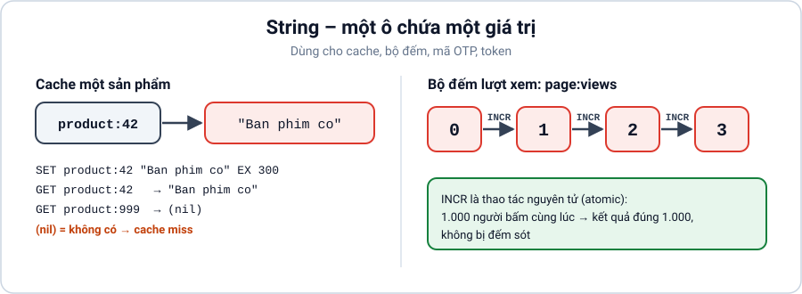

**Dùng khi:** cache, đếm số lượt, lưu mã OTP, token đăng nhập.

**Ví dụ 1: cache sản phẩm trong 5 phút**

```text
> SET product:42 "Ban phim co" EX 300
OK
> GET product:42
"Ban phim co"
> GET product:999
(nil)                       ← cache miss: sản phẩm chưa có trong cache
```

**Ví dụ 2: đếm lượt xem trang**

```text
> INCR page:views
(integer) 1
> INCR page:views
(integer) 2                 ← mỗi lần gọi tăng thêm 1
```

> `INCR` an toàn khi nhiều người gọi cùng lúc: 1.000 người bấm cùng lúc thì kết quả là đúng 1.000, không bị đếm sót.

---

### 4.2. List: danh sách có thứ tự

**Hình dung:** một hàng người xếp hàng. Có thể thêm/lấy ở **đầu** (Left) hoặc **cuối** (Right).

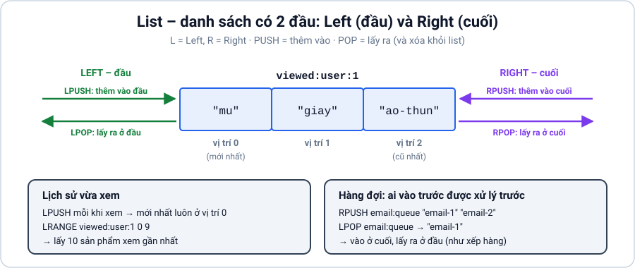

**Dùng khi:** lịch sử xem gần đây, hàng đợi công việc đơn giản.

**Ví dụ 1: "Sản phẩm bạn vừa xem"**

```text
> LPUSH viewed:user:1 "ao-thun"       ← xem áo thun, thêm vào đầu
(integer) 1                           ← danh sách giờ có 1 phần tử
> LPUSH viewed:user:1 "giay"
(integer) 2
> LPUSH viewed:user:1 "mu"
(integer) 3
> LRANGE viewed:user:1 0 9            ← lấy 10 phần tử đầu (vị trí 0 đến 9)
1) "mu"                               ← mới xem nhất
2) "giay"
3) "ao-thun"                          ← xem đầu tiên
```

**Ví dụ 2: hàng đợi gửi email** (vào cuối, lấy ra ở đầu, giống xếp hàng mua vé)

```text
> RPUSH email:queue "email-1" "email-2"
(integer) 2
> LPOP email:queue
"email-1"                             ← ai vào trước được xử lý trước
```

> Lệnh viết tắt: `L` = Left (đầu), `R` = Right (cuối). `LPUSH` = thêm vào đầu, `RPUSH` = thêm vào cuối, `LPOP` = lấy ra ở đầu.

---

### 4.3. Set: tập hợp không trùng lặp

**Hình dung:** một túi đựng thẻ tên. Bỏ thẻ "redis" vào 2 lần thì trong túi vẫn chỉ có **1 thẻ** "redis". Không quan tâm thứ tự.

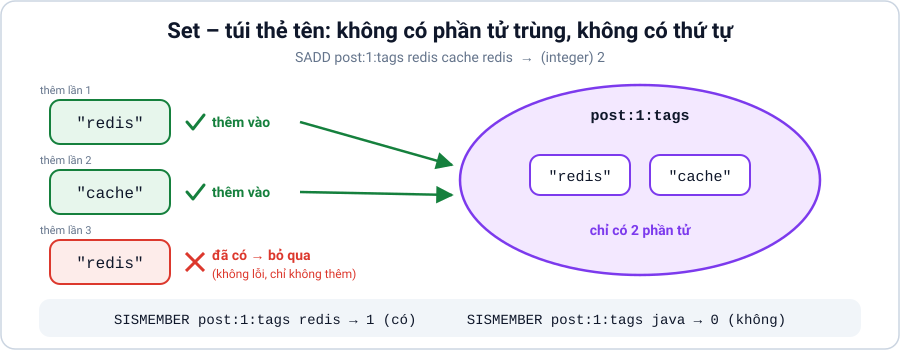

**Dùng khi:** danh sách tag, danh sách người đã like (mỗi người chỉ like 1 lần), kiểm tra "X có trong danh sách không?".

**Ví dụ: tag của bài viết**

```text
> SADD post:1:tags redis cache redis
(integer) 2                           ← chỉ thêm được 2, vì "redis" bị trùng
> SMEMBERS post:1:tags
1) "redis"
2) "cache"                            ← thứ tự có thể khác trên máy bạn
> SISMEMBER post:1:tags redis
(integer) 1                           ← 1 = có, 0 = không
```

---

### 4.4. Hash: một object có nhiều trường

**Hình dung:** một tấm phiếu thông tin cá nhân, có nhiều dòng (field) và mỗi dòng có giá trị riêng. Giống một object trong C#.

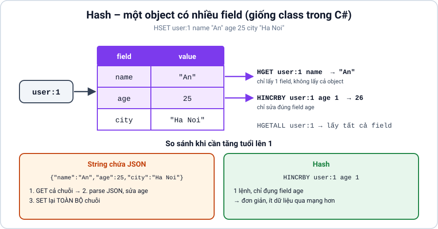

**Dùng khi:** lưu thông tin user, sản phẩm, giỏ hàng, tức là những thứ có nhiều thuộc tính.

**Ví dụ: hồ sơ người dùng**

```text
> HSET user:1 name "An" age 25 city "Ha Noi"
(integer) 3                           ← đã tạo 3 field
> HGET user:1 name
"An"                                  ← chỉ lấy 1 field, không cần lấy cả object
> HINCRBY user:1 age 1
(integer) 26                          ← tăng tuổi lên 1
> HGETALL user:1
1) "name"                             ← kết quả xen kẽ: field, value, field, value...
2) "An"
3) "age"
4) "26"
5) "city"
6) "Ha Noi"
```

> **So với String chứa JSON:** nếu lưu cả user thành một chuỗi JSON, muốn sửa tuổi thì phải đọc cả chuỗi, sửa, rồi ghi lại toàn bộ. Với Hash, bạn chỉ cần sửa đúng field `age`.

---

### 4.5. Sorted Set: tập hợp có điểm số, tự sắp xếp

**Hình dung:** bảng xếp hạng trong game. Mỗi người chơi (member) có một **điểm (score)**, Redis **tự động sắp xếp** theo điểm. Mỗi người chỉ xuất hiện 1 lần.

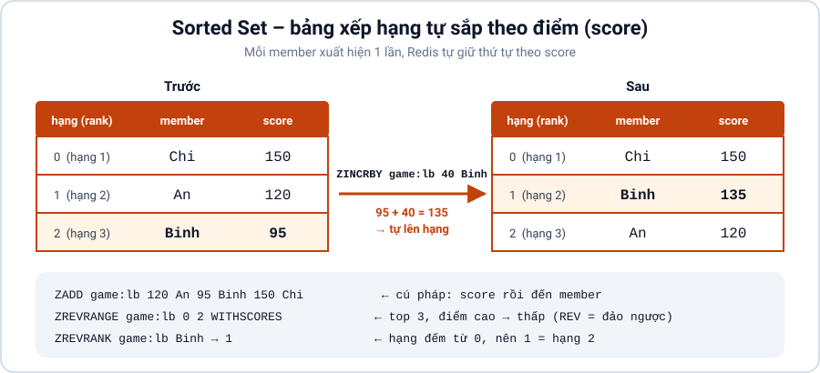

**Dùng khi:** bảng xếp hạng, top sản phẩm bán chạy, sắp xếp theo thời gian.

**Ví dụ: bảng xếp hạng game**

```text
> ZADD game:lb 120 An 95 Binh 150 Chi       ← cú pháp: điểm rồi đến tên
(integer) 3
> ZREVRANGE game:lb 0 2 WITHSCORES          ← top 3, điểm cao xuống thấp
1) "Chi"
2) "150"
3) "An"
4) "120"
5) "Binh"
6) "95"
> ZINCRBY game:lb 40 Binh                   ← Bình được cộng thêm 40 điểm
"135"
> ZREVRANK game:lb Binh                     ← Bình đang hạng mấy?
(integer) 1                                 ← hạng đếm từ 0, nên 1 = hạng 2
```

> Lệnh viết tắt: `Z` = Sorted Set, `REV` = reverse (đảo ngược, tức là sắp từ cao xuống thấp).

---

### 4.6. Stream: sổ ghi sự kiện

**Hình dung:** cuốn sổ nhật ký đơn hàng. Mỗi dòng được đánh số thứ tự theo thời gian và **không bị mất sau khi đọc**. Nhiều nhân viên có thể chia nhau xử lý từng dòng.

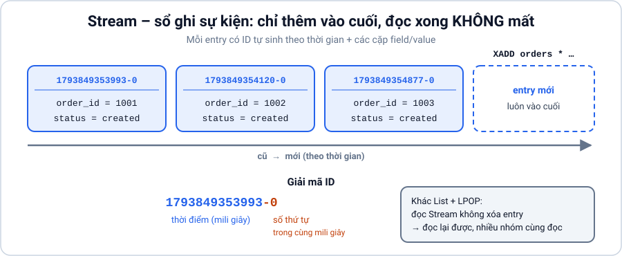

**Dùng khi:** xử lý đơn hàng, ghi log sự kiện, hàng đợi cần đảm bảo không mất message. Chi tiết xem mục 5.3.

```text
> XADD orders * order_id 1001 status created   ← dấu * = để Redis tự sinh ID
"1793849353993-0"
> XLEN orders
(integer) 1
```

---

### 4.7. Bảng tóm tắt: "Tôi cần… thì dùng…"

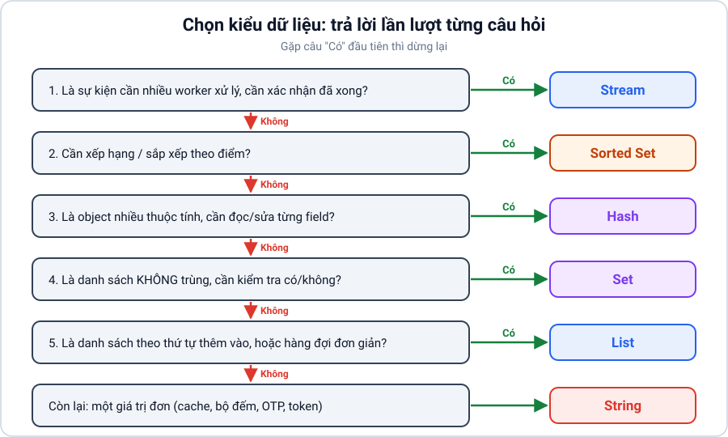

| Tôi cần… | Dùng kiểu | Lệnh chính |
|---|---|---|
| Lưu tạm một giá trị, có hạn sử dụng | **String** | `SET ... EX`, `GET` |
| Đếm (lượt xem, lượt like) | **String** | `INCR` |
| Danh sách theo thứ tự thêm vào, hàng đợi đơn giản | **List** | `LPUSH`, `RPUSH`, `LPOP`, `LRANGE` |
| Danh sách không trùng, kiểm tra "có/không" | **Set** | `SADD`, `SISMEMBER`, `SMEMBERS` |
| Lưu một object nhiều thuộc tính | **Hash** | `HSET`, `HGET`, `HGETALL` |
| Bảng xếp hạng, sắp xếp theo điểm | **Sorted Set** | `ZADD`, `ZREVRANGE`, `ZINCRBY` |
| Ghi sự kiện, nhiều worker chia nhau xử lý | **Stream** | `XADD`, `XREADGROUP`, `XACK` |

---

## 5. Bốn cách dùng Redis phổ biến

Cùng một Redis server có thể dùng cho 4 mục đích khác nhau. Không cần cài 4 thứ khác nhau.

### 5.1. Cache: lưu tạm để đọc nhanh

**Quy trình chuẩn (gọi là _cache-aside_):**

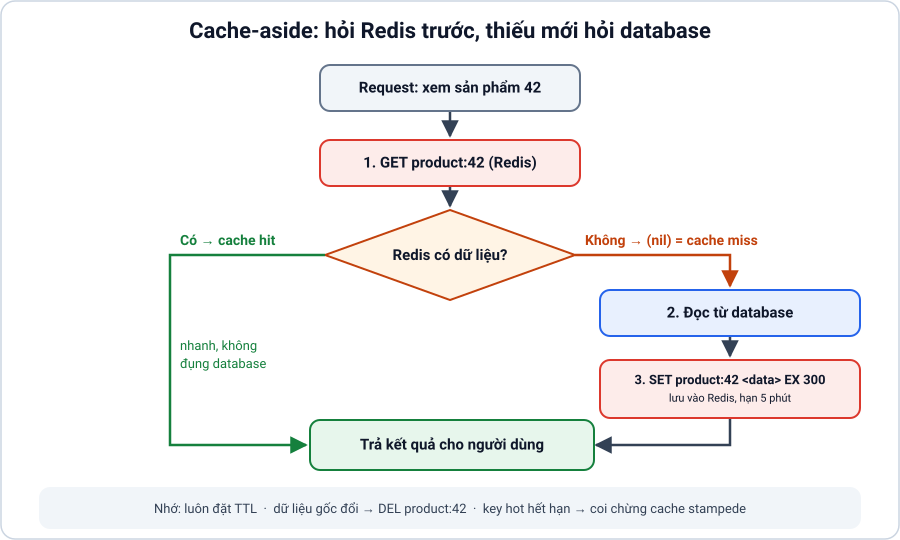

**Ba điều cần nhớ:**

1. **Luôn đặt TTL cho cache.** Nếu không, dữ liệu cũ sẽ nằm mãi trong Redis và chiếm RAM.
2. **Khi dữ liệu gốc thay đổi** (ví dụ admin sửa giá sản phẩm), xóa cache bằng `DEL product:42` để lần sau đọc lại dữ liệu mới.
3. **Cache stampede** (giẫm đạp): khi một key "hot" hết hạn, hàng nghìn request cùng lúc bị miss và cùng đổ vào database. Cách giảm: cho TTL lệch nhau ngẫu nhiên vài giây, hoặc chỉ cho 1 request được đọc database rồi các request khác đợi.

### 5.2. Pub/Sub: phát thông báo tức thời

**Hình dung:** loa phát thanh. Ai đang **bật đài** (đang subscribe) thì nghe được. Ai tắt đài thì **mất luôn tin đó**, không có ghi âm để nghe lại.

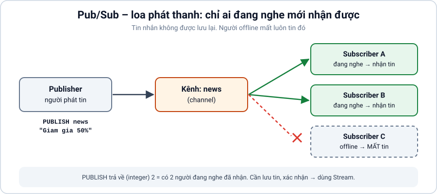

```text
Terminal A (người nghe):          Terminal B (người phát):
> SUBSCRIBE news                  > PUBLISH news "Giam gia 50%"
1) "message"                      (integer) 1    ← có 1 người đang nghe
2) "news"
3) "Giam gia 50%"
```

**Dùng khi:** thông báo realtime như chat, cập nhật giao diện, báo các server khác xóa cache. Chấp nhận được việc người offline không nhận được tin.

**Không dùng khi:** cần chắc chắn message được xử lý (ví dụ đơn hàng, thanh toán) → dùng Stream.

### 5.3. Stream: hàng đợi tin cậy, có xác nhận

**Hình dung:** bếp nhà hàng.

- Phục vụ ghi order vào **sổ** (`XADD`). Sổ không bị xé sau khi đọc.
- Nhóm đầu bếp (**consumer group**) chia nhau nhận order (`XREADGROUP`). Mỗi order chỉ giao cho **một** đầu bếp trong nhóm.
- Nấu xong, đầu bếp **đánh dấu "xong"** (`XACK`, viết tắt của acknowledge = xác nhận).
- Order đã nhận mà chưa đánh dấu xong nằm trong danh sách **pending** (đang chờ). Nếu đầu bếp đó nghỉ giữa chừng, người khác có thể nhận lại order.

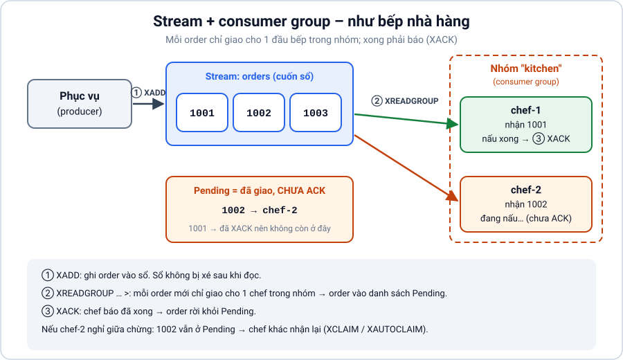

```text
> XADD orders * order_id 1001 status created
"1793849353993-0"
> XGROUP CREATE orders kitchen 0                  ← tạo nhóm "kitchen", đọc từ đầu sổ
OK
> XREADGROUP GROUP kitchen chef-1 COUNT 1 STREAMS orders >
1) 1) "orders"                                    ← dấu > = "đưa tôi order mới chưa ai nhận"
   2) 1) 1) "1793849353993-0"
         2) 1) "order_id"
            2) "1001"
            3) "status"
            4) "created"
> XACK orders kitchen 1793849353993-0             ← chef-1 xác nhận đã xử lý xong
(integer) 1
```

**So sánh nhanh:**

| | Pub/Sub | Stream |
|---|---|---|
| Message có được lưu lại không? | ❌ Không | ✅ Có |
| Người offline nhận lại được không? | ❌ Không | ✅ Có |
| Có xác nhận đã xử lý (ACK) không? | ❌ Không | ✅ Có |
| Độ phức tạp | Đơn giản | Phức tạp hơn |

> ⚠️ Một message có thể bị xử lý **2 lần** (ví dụ chef-1 nấu xong nhưng chưa kịp ACK thì bị lỗi, order được giao lại cho chef-2). Vì vậy code xử lý nên **idempotent**: chạy 2 lần vẫn cho kết quả như 1 lần. Ví dụ, trước khi trừ tiền, kiểm tra đơn đã được trừ tiền chưa.

### 5.4. Database: lưu dữ liệu chính

Redis có thể làm database chính cho dữ liệu như session đăng nhập, giỏ hàng, bảng xếp hạng. Nhưng cần nhớ:

- Dữ liệu nằm trên RAM, **mà RAM đắt và có giới hạn**.
- Redis không có `JOIN`, không có truy vấn phức tạp như SQL.
- Muốn không mất dữ liệu khi tắt máy, phải cấu hình lưu xuống đĩa (mục 7).

→ Thường dùng Redis **bên cạnh** database chính (SQL Server, PostgreSQL…), không thay thế hoàn toàn.

---

## 6. Redis "đơn luồng": vì sao một lệnh chậm làm tất cả cùng chậm?

### Hình dung

Redis giống một **quầy thu ngân chỉ có 1 nhân viên**. Nhân viên làm cực nhanh, mỗi khách chỉ mất khoảng 1 giây. Nhưng nếu có một khách mang **10.000 món hàng** (một lệnh nặng), cả hàng phía sau phải chờ.

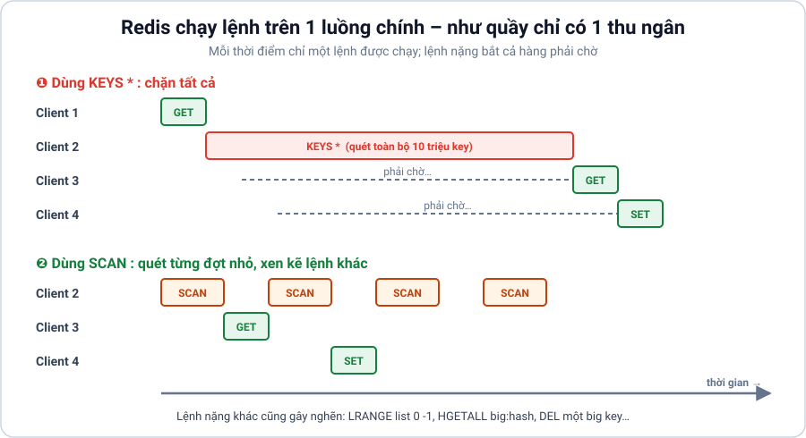

> Ghi chú thêm: Redis mới có dùng thêm luồng phụ cho việc nhận/gửi dữ liệu qua mạng (I/O threads), nhưng **việc chạy lệnh vẫn là một luồng chính**. Lệnh nặng vẫn làm nghẽn.

### Cách khắc phục

| Vấn đề | Cách làm sai | Cách làm đúng |
|---|---|---|
| Tìm key theo mẫu | `KEYS user:*` (quét hết một lần) | `SCAN 0 MATCH user:* COUNT 100` (quét từng đợt nhỏ) |
| Lấy cả danh sách lớn | `LRANGE list 0 -1` (lấy hết) | `LRANGE list 0 99` (lấy theo trang) |
| Lấy cả hash lớn | `HGETALL big:hash` | `HGET` từng field cần, hoặc `HSCAN` |
| Gửi nhiều lệnh | Gửi 10.000 lệnh, mỗi lệnh chờ một lần | Dùng **pipeline** (gửi gộp), chia mỗi lô khoảng 100 – 1.000 lệnh |

> **Pipeline** là gửi nhiều lệnh trong một lần qua mạng thay vì gửi từng lệnh rồi chờ. Giống gom 10 lá thư vào 1 phong bì thay vì gửi 10 lần.

---

## 7. Lưu dữ liệu xuống ổ đĩa (Persistence)

RAM mất điện là mất dữ liệu. Redis có 2 cách ghi dữ liệu xuống ổ đĩa để khôi phục khi khởi động lại:

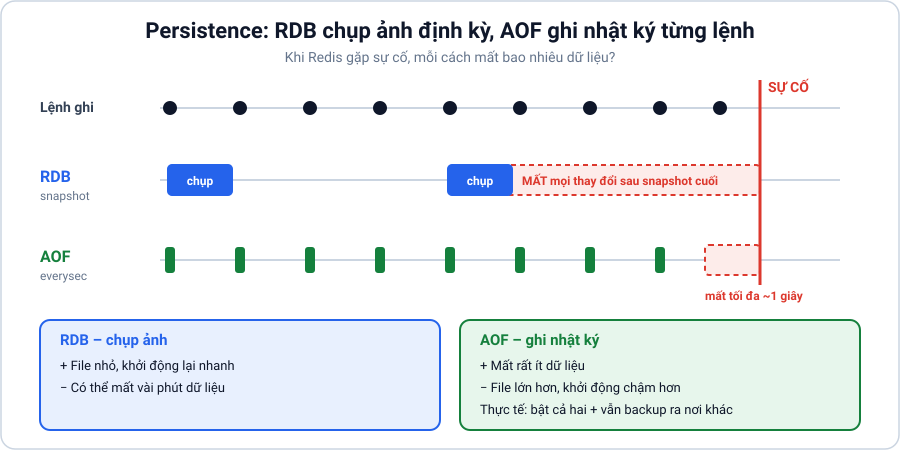

| | **RDB** (snapshot) | **AOF** (Append Only File) |
|---|---|---|
| Hình dung | **Chụp ảnh** toàn bộ dữ liệu định kỳ (ví dụ 5 phút/lần) | **Ghi nhật ký** từng lệnh thay đổi dữ liệu |
| Khi sự cố | Mất dữ liệu từ lần chụp cuối đến lúc sự cố (có thể vài phút) | Mất rất ít (thường tối đa khoảng 1 giây, tùy cấu hình) |
| Kích thước file | Nhỏ gọn | Lớn hơn |
| Khởi động lại | Nhanh | Chậm hơn (phải "chạy lại" nhật ký) |

**Thực tế:** thường bật **cả hai**.

> ⚠️ Persistence **không phải backup**. Nếu ổ đĩa hỏng, file cũng mất theo. Vẫn cần sao chép file backup sang nơi khác và **thử khôi phục** định kỳ.

---

## 8. Replication và Cluster

### Replication: sao chép dữ liệu

**Hình dung:** một giáo viên (**primary**) giảng bài, các trợ giảng (**replica**) chép lại y hệt.

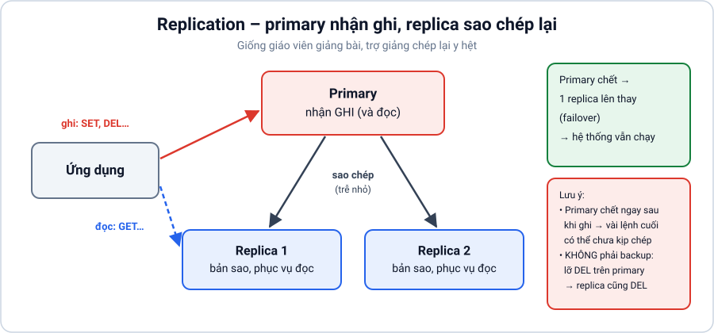

- **Lợi ích:** primary chết thì một replica lên thay (**failover**). Có thể chia việc đọc cho replica.
- **Lưu ý:** việc sao chép có độ trễ nhỏ. Primary vừa ghi xong rồi chết ngay thì vài lệnh cuối có thể chưa kịp sang replica → **mất**.
- Replication **không phải backup**: nếu lỡ tay xóa dữ liệu trên primary, lệnh xóa cũng được chép sang replica.

### Cluster: chia nhỏ dữ liệu ra nhiều máy

**Hình dung:** thư viện quá lớn nên chia thành nhiều phòng. Sách vần A–F ở phòng 1, G–M ở phòng 2…

- Redis Cluster chia dữ liệu thành **16.384 ngăn (hash slot)**. Mỗi key được tính toán để rơi vào 1 ngăn, các ngăn được chia cho nhiều máy.
- **Dùng khi:** dữ liệu quá lớn cho 1 máy, hoặc 1 máy không chịu nổi lượng request.
- **Hạn chế:** lệnh thao tác nhiều key cùng lúc (ví dụ `SINTER set1 set2`) chỉ chạy được khi các key nằm **cùng ngăn**. Muốn ép các key vào cùng ngăn, dùng **hash tag** `{...}`: `{user:1}:cart` và `{user:1}:profile` sẽ cùng ngăn vì phần trong `{}` giống nhau.

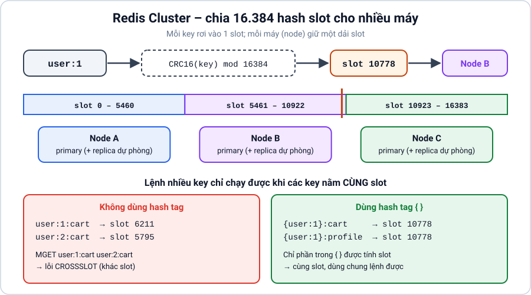

| | Replication | Cluster |
|---|---|---|
| Mục đích | Dự phòng, chia tải đọc | Chứa nhiều dữ liệu hơn, chia tải ghi |
| Dữ liệu mỗi máy | Giống hệt nhau | Mỗi máy giữ một phần |

---

## 9. Quản lý bộ nhớ: TTL, `maxmemory`, eviction

RAM có hạn. Có 2 cơ chế giải phóng bộ nhớ, rất hay bị nhầm:

| | **Expiration** (hết hạn) | **Eviction** (đuổi bớt) |
|---|---|---|
| Khi nào xảy ra | Khi TTL của key về 0 | Khi Redis dùng hết `maxmemory` |
| Ai quyết định | **Bạn**, qua việc đặt TTL | **Redis**, theo chính sách bạn chọn |
| Hình dung | Hộp sữa quá hạn thì vứt | Tủ lạnh đầy, phải vứt bớt đồ để chỗ cho đồ mới |

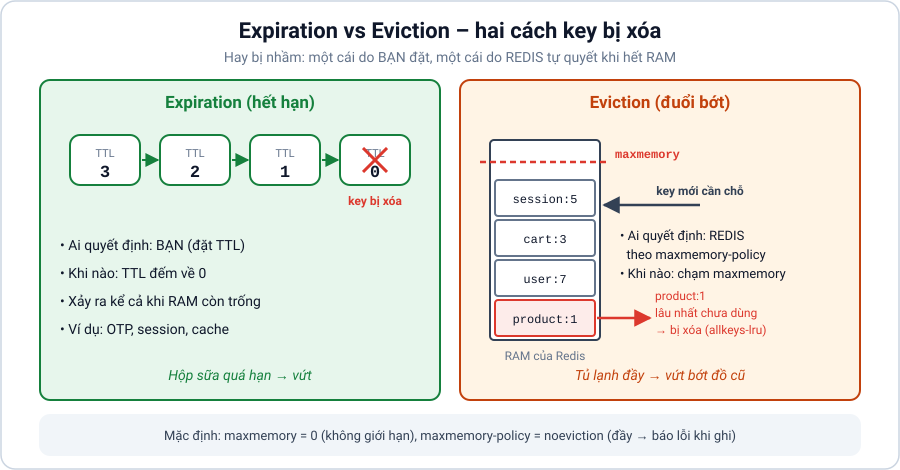

### `maxmemory`: giới hạn RAM cho Redis

```text
> CONFIG GET maxmemory
1) "maxmemory"
2) "0"              ← 0 = không giới hạn (nguy hiểm: Redis có thể dùng hết RAM máy)
```

Nên đặt khoảng **70 – 80% RAM** dành cho Redis, chừa phần còn lại cho hệ điều hành và các hoạt động phụ của Redis (như ghi file RDB).

### Chính sách eviction (`maxmemory-policy`)

| Chính sách | Khi đầy RAM thì… | Phù hợp với |
|---|---|---|
| `noeviction` (mặc định) | **Từ chối ghi mới**, báo lỗi | Redis làm database, không được mất dữ liệu |
| `allkeys-lru` | Xóa key **lâu nhất chưa được dùng** | Cache thông thường ✅ |
| `allkeys-lfu` | Xóa key **ít được dùng nhất** | Cache có vài key "hot" được đọc liên tục |
| `volatile-lru` / `volatile-lfu` | Như trên nhưng **chỉ xét key có TTL** | Redis vừa làm cache vừa lưu dữ liệu lâu dài |

> **LRU** = Least Recently Used (lâu nhất chưa dùng). **LFU** = Least Frequently Used (ít dùng nhất).

---

## 10. Bốn lỗi phổ biến khi dùng Redis

### ❌ Lỗi 1: Dùng `KEYS *` trên production

**Vì sao sai:** `KEYS` quét **toàn bộ** key trong một lần. Có 10 triệu key → Redis "đứng hình" vài giây, mọi request khác phải chờ (xem mục 6).

**Cách đúng:** dùng `SCAN`. Lệnh này quét từng đợt nhỏ, giữa các đợt Redis vẫn phục vụ request khác (xem hình ở mục 6).

```text
> SCAN 0 MATCH user:* COUNT 100
1) "1792"                 ← cursor (con trỏ): vị trí để quét tiếp lần sau
2) 1) "user:15"
   2) "user:3"
> SCAN 1792 MATCH user:* COUNT 100      ← dùng cursor vừa nhận
1) "0"                    ← cursor = 0 nghĩa là đã quét xong
2) 1) "user:7"
```

> `SCAN` có thể trả về một key **nhiều lần**, và mỗi đợt có thể trả về 0 key nhưng chưa xong. Chỉ dừng khi cursor trả về `"0"`.

### ❌ Lỗi 2: Không đặt TTL

**Vì sao sai:** dữ liệu tạm (cache, session, OTP) không bao giờ bị xóa → RAM đầy dần → Redis từ chối ghi hoặc xóa nhầm dữ liệu quan trọng.

**Cách đúng:** dữ liệu tạm **luôn** có TTL. Dữ liệu lâu dài (không có TTL) phải có kế hoạch dọn dẹp rõ ràng.

### ❌ Lỗi 3: Big key (key quá lớn)

**Big key** là một key chứa quá nhiều dữ liệu, ví dụ một String 10 MB, hoặc một List 1 triệu phần tử.

**Vì sao sai:** đọc, ghi hoặc xóa key này tốn nhiều thời gian (làm nghẽn quầy thu ngân ở mục 6) và gửi nhiều dữ liệu qua mạng.

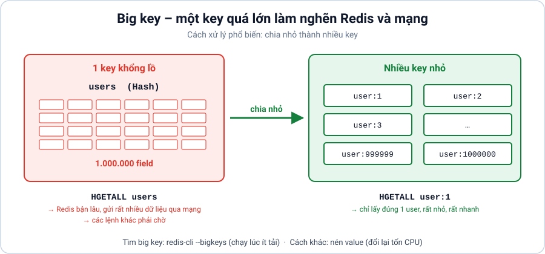

**Cách đúng:**

- **Chia nhỏ:** thay vì 1 hash `users` chứa 1 triệu user, dùng `user:1`, `user:2`… mỗi user 1 key.
- **Nén:** nén JSON (ví dụ gzip) trước khi lưu. Đổi lại tốn CPU để nén/giải nén.
- **Tìm big key:** `redis-cli --bigkeys` (chạy lúc ít người dùng).

### ❌ Lỗi 4: Không cấu hình `maxmemory`

**Vì sao sai:** mặc định `maxmemory = 0` (không giới hạn). Redis có thể dùng hết RAM của máy → hệ điều hành "giết" Redis để cứu máy.

**Cách đúng:** đặt `maxmemory` và chọn `maxmemory-policy` phù hợp (xem mục 9).

---

## 11. Khi nào nên và không nên dùng Redis?

| ✅ Nên dùng khi | ❌ Không nên dùng khi |
|---|---|
| Cần đọc/ghi **rất nhanh** (dưới 1 ms) | Dữ liệu **lớn hơn RAM** có thể chi trả |
| Cache dữ liệu đọc nhiều, ít thay đổi | Cần truy vấn phức tạp (`JOIN`, `GROUP BY`, báo cáo) |
| Đếm, giới hạn số request (rate limit) | Cần đảm bảo **tuyệt đối** không mất dữ liệu (giao dịch ngân hàng) |
| Session đăng nhập, mã OTP, token | Dữ liệu ít được đọc, chỉ cần lưu trữ lâu dài |
| Bảng xếp hạng, realtime, hàng đợi | |

---

## 12. Chạy ví dụ C#

Project `redis_examples.csproj` dùng thư viện **StackExchange.Redis**, thư viện Redis phổ biến nhất cho .NET.

```bash
# Cài .NET 8 SDK: https://dotnet.microsoft.com/download
dotnet run --project redis_examples.csproj
```

**Kết quả mong đợi** (giá trị ID stream sẽ khác):

```text
cache: cached product response
hash: {name=Ada, role=learner}
list: [opened lesson 1, opened lesson 2]
set: [database, redis]
leaderboard: [Ada=120, Lin=95]
pubsub: refresh
stream: 1793849353993-0 {event=lesson-completed, user=Ada}
```

**Lệnh Redis ↔ hàm C#:**

| Lệnh Redis | Hàm StackExchange.Redis |
|---|---|
| `SET key value EX 60` | `db.StringSetAsync(key, value, TimeSpan.FromSeconds(60))` |
| `GET key` | `db.StringGetAsync(key)` |
| `INCR key` | `db.StringIncrementAsync(key)` |
| `LPUSH` / `LRANGE` | `db.ListLeftPushAsync` / `db.ListRangeAsync` |
| `SADD` / `SMEMBERS` | `db.SetAddAsync` / `db.SetMembersAsync` |
| `HSET` / `HGETALL` | `db.HashSetAsync` / `db.HashGetAllAsync` |
| `ZADD` / `ZREVRANGE ... WITHSCORES` | `db.SortedSetAddAsync` / `db.SortedSetRangeByRankWithScoresAsync(..., Order.Descending)` |
| `PUBLISH` / `SUBSCRIBE` | `subscriber.PublishAsync` / `subscriber.SubscribeAsync` |
| `XADD` / `XREADGROUP` / `XACK` | `db.StreamAddAsync` / `db.StreamReadGroupAsync` / `db.StreamAcknowledgeAsync` |
| `DEL key` | `db.KeyDeleteAsync(key)` |

> 💡 Trong ứng dụng thật, chỉ tạo **một** `ConnectionMultiplexer` và dùng lại cho toàn bộ ứng dụng (đăng ký Singleton trong DI). Đừng tạo kết nối mới cho mỗi request.

---

## Bảng thuật ngữ

| Thuật ngữ | Giải thích |
|---|---|
| **ACK** (acknowledge) | Xác nhận đã xử lý xong một message Stream (`XACK`). |
| **Atomic** (nguyên tử) | Lệnh chạy trọn vẹn một lần, không bị lệnh khác chen vào giữa. Ví dụ `INCR` an toàn khi nhiều người gọi cùng lúc. |
| **Big key** | Key chứa quá nhiều dữ liệu, làm chậm Redis khi đọc, ghi hoặc xóa. |
| **Cache stampede** | Nhiều request cùng bị cache miss một lúc và cùng dồn vào database. |
| **Consumer group** | Nhóm worker cùng đọc một Stream, mỗi message chỉ giao cho một worker trong nhóm. |
| **Cursor** | "Con trỏ" đánh dấu vị trí đang quét dở trong `SCAN`. |
| **Eviction** | Redis tự xóa bớt key khi hết `maxmemory`. |
| **Expiration** | Key tự xóa khi hết TTL. |
| **Failover** | Tự động chuyển replica lên làm primary khi primary gặp sự cố. |
| **Hash slot** | Một trong 16.384 "ngăn" mà Redis Cluster dùng để chia dữ liệu. |
| **Idempotent** | Chạy một thao tác nhiều lần vẫn cho kết quả như chạy một lần. |
| **Latency** (độ trễ) | Thời gian từ lúc gửi lệnh đến lúc nhận kết quả. |
| **Pending** | Message Stream đã giao cho worker nhưng chưa được ACK. |
| **Persistence** | Lưu dữ liệu từ RAM xuống ổ đĩa (RDB, AOF). |
| **Pipeline** | Gửi gộp nhiều lệnh trong một lần qua mạng. |
| **Primary / Replica** | Máy chính nhận ghi / máy phụ sao chép dữ liệu từ máy chính. |
| **Production (prod)** | Môi trường thật, nơi người dùng thật đang sử dụng. |
| **RPO** | Lượng dữ liệu tối đa chấp nhận mất khi có sự cố (ví dụ "mất tối đa 1 phút dữ liệu"). |
| **RTO** | Thời gian tối đa chấp nhận để khôi phục hệ thống (ví dụ "phải chạy lại trong 10 phút"). |

---

## Tài liệu đọc trực tiếp

Tài liệu chính thức của Redis (tiếng Anh). Đề xuất đọc theo thứ tự:

**Bắt đầu:**

1. [Redis documentation: trang chủ](https://redis.io/docs/latest/)
2. [Redis data types: tổng quan các kiểu dữ liệu](https://redis.io/docs/latest/develop/data-types/)
3. [Strings](https://redis.io/docs/latest/develop/data-types/strings/) · [Lists](https://redis.io/docs/latest/develop/data-types/lists/) · [Sets](https://redis.io/docs/latest/develop/data-types/sets/) · [Hashes](https://redis.io/docs/latest/develop/data-types/hashes/) · [Sorted sets](https://redis.io/docs/latest/develop/data-types/sorted-sets/)
4. [StackExchange.Redis: thư viện .NET](https://stackexchange.github.io/StackExchange.Redis/)

**Trung cấp:**

5. [Pub/Sub](https://redis.io/docs/latest/develop/pubsub/)
6. [Streams](https://redis.io/docs/latest/develop/data-types/streams/)
7. [SCAN](https://redis.io/docs/latest/commands/scan/)
8. [Key eviction và maxmemory](https://redis.io/docs/latest/develop/reference/eviction/)

**Vận hành / nâng cao:**

9. [Persistence (RDB, AOF)](https://redis.io/docs/latest/operate/oss_and_stack/management/persistence/)
10. [Replication](https://redis.io/docs/latest/operate/oss_and_stack/management/replication/)
11. [Cluster specification](https://redis.io/docs/latest/operate/oss_and_stack/reference/cluster-spec/)
12. [Latency diagnosis: chẩn đoán độ trễ](https://redis.io/docs/latest/operate/oss_and_stack/management/optimization/latency/)
13. [Client handling](https://redis.io/docs/latest/develop/reference/clients/)
